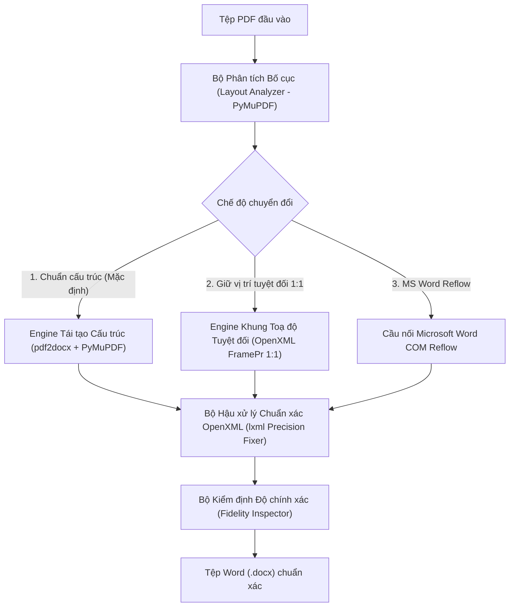

# Báo cáo Nghiên cứu & Đề xuất Công nghệ cho QT PDF Pro

> Tài liệu này phân tích chuyên sâu bài toán xây dựng **QT PDF Pro** — ứng dụng chuyên đọc PDF và chuyển đổi **PDF sang DOCX với độ chính xác cực cao**, giải thích vì sao các công cụ thông thường làm lệch bố cục khi mở trong Microsoft Word và đề xuất kiến trúc công nghệ tối ưu nhất.

---

## 1. Bản chất bài toán: Vì sao chuyển PDF sang DOCX thường bị lệch bố cục?

Hầu hết các công cụ chuyển đổi PDF sang Word miễn phí hoặc thư viện mã nguồn mở đơn lẻ đều gặp hiện tượng **"vỡ khung, nhảy dòng, tràn trang, lỗi phông tiếng Việt"** vì sự khác biệt bản chất giữa hai định dạng:

| Tiêu chí | Định dạng PDF (ISO 32000) | Định dạng Word DOCX (ECMA-376 OpenXML) |
|---|---|---|
| **Mô hình bố cục** | **Toạ độ tuyệt đối (Fixed Layout)**: Mỗi ký tự (glyph), đoạn kẻ vector, hình ảnh được vẽ tại toạ độ `(x, y)` cố định trên trang. Không có khái niệm "đoạn văn", "bảng biểu" hay "cột" thực sự. | **Dòng chảy tài liệu (Flow Layout)**: Nội dung gồm các `Section` → `Paragraph` → `Run` và `Table`. Vị trí hiển thị do Microsoft Word tự tính toán lại khi mở tệp. |
| **Quản lý phông chữ** | Nhúng phông con (subset font) với tên tiền tố ngẫu nhiên như `BCDEFG+TimesNewRomanPS-BoldMT` hoặc mã glyph tuỳ chỉnh. | Dựa vào tên phông cài trên hệ điều hành (`Times New Roman`, `Arial`). Nếu tên không khớp chính xác, Word tự thay thế bằng `Calibri` hoặc phông mặc định. |
| **Độ cao dòng & lưới trang** | Khoảng cách dòng tính bằng hiệu số toạ độ `y` giữa hai đường cơ sở (baseline). | Mặc định bật `w:snapToGrid="1"` (bắt dính lưới dòng) và cộng thêm khoảng đệm `winAscent`/`winDescent` (~12–15% cao hơn PDF). |
| **Bảng biểu (Table)** | Chỉ là tập hợp các đoạn thẳng vector rời rạc (`stroke`/`rect`) hoặc các cột chữ xếp thẳng hàng (bảng ẩn viền). | Bảng thực sự (`<w:tbl>`) có khoảng đệm ô mặc định (`left/right = 108 dxa = 5.4pt` mỗi bên), làm thu hẹp chiều rộng chứa chữ bên trong ô. |

### 6 nguyên nhân trực tiếp gây sai lệch khi mở trong Word:
1. **Sai tên phông chữ PostScript/Subset**: Thư viện chuyển đổi ghi nguyên tên `ABCDEF+TimesNewRomanPSMT` vào DOCX. Word không hiểu đây là `Times New Roman`, tự đổi sang `Calibri` → độ rộng chữ thay đổi → dòng chữ bị gãy sớm hoặc tràn lề.
2. **Đệm ô bảng (`Cell Padding`) làm rớt dòng trong bảng**: Một ô bảng trên PDF rộng `60pt` chứa chữ dài `55pt`. Khi sang Word, Word tự trừ `10.8pt` lề trái/phải mặc định của ô, chỉ còn `49.2pt` → chữ trong bảng bị ép xuống dòng thứ 2, làm giãn chiều cao hàng và đẩy lệch toàn bộ trang.
3. **Bắt dính lưới trang (`SnapToGrid`) và giãn dòng tự động**: Word tự làm tròn chiều cao dòng theo lưới tài liệu, khiến một trang PDF 40 dòng khi sang Word bị cao thêm 10% và tràn 3–4 dòng cuối sang trang mới.
4. **Lỗi phông & tổ hợp dấu tiếng Việt**: Ký tự tiếng Việt trong PDF đôi khi tách rời chữ cái và dấu thanh (Unicode NFD: `a` + `\u0300`), hoặc dùng bảng mã cũ (TCVN3 `.VnTime`, VNI `VNI-Times`), hoặc thiếu khai báo thuộc tính `w:cs`/`w:eastAsia`/`w:hAnsi` trong XML khiến các chữ `ă, â, đ, ê, ô, ơ, ư` bị hiển thị bằng phông khác với các chữ cái thường trong cùng một từ.
5. **Khối song song không viền (Quốc hiệu – Tiêu ngữ, Nơi nhận – Ký tên)**: Văn bản hành chính Việt Nam có phần đầu trang 2 cột không viền và phần chân chữ ký. Nếu nhận diện thành đoạn văn thường nối tiếp nhau bằng dấu cách/tab thì khi sang Word sẽ bị xô lệch hoàn toàn.
6. **Biểu mẫu phức tạp, con dấu, chữ ký đè lên chữ**: Các tài liệu có con dấu, khung biểu mẫu nhiều tầng không thể biểu diễn bằng đoạn văn chảy thông thường mà cần khung định vị toạ độ tuyệt đối (`OpenXML Frame / Anchor`).

---

## 2. So sánh các nền tảng công nghệ phát triển ứng dụng

| Phương án công nghệ | Ưu điểm | Nhược điểm | Đánh giá độ phù hợp |
|---|---|---|---|
| **1. Python 3.14 + PySide6 (Qt6) + PyMuPDF + Hybrid OpenXML Engine** *(Đề xuất số 1)* | - **Hiệu năng đọc PDF cực nhanh**: `PyMuPDF` (MuPDF C engine) kết xuất trang PDF sang bộ đệm `QImage`/`QPixmap` của Qt trong vài mili-giây, tốn rất ít RAM. - **Hệ sinh thái xử lý PDF/DOCX mạnh nhất**: Trực tiếp dùng `PyMuPDF`, `pdf2docx`, `python-docx`, `lxml` (can thiệp sâu XML của Word), `fonttools`, `opencv`, và cầu nối COM `WINWORD.EXE`. - **1 ngôn ngữ duy nhất**, đóng gói `.exe` độc lập bằng PyInstaller, đồng bộ hoàn toàn với môi trường sẵn có trên máy phát triển. | Giao diện Qt cần thiết kế QSS bài bản để đạt độ thẩm mỹ hiện đại chuẩn Windows 11. | **9.8 / 10 (Tốt nhất)** |
| **2. Electron / Tauri (React + PDF.js) + Python Sidecar** | - Giao diện HTML/CSS dễ tuỳ biến hiệu ứng. - `PDF.js` hỗ trợ sẵn lớp chọn văn bản trên trình duyệt. | - Phải duy trì 2 môi trường (Node/Rust + Python backend). - Electron ngốn 300–600 MB RAM khi mở tệp PDF lớn. - Giao tiếp IPC giữa UI và Python làm chậm tính năng soi bố cục trực tiếp trên trang. | **7.5 / 10** |
| **3. C# / .NET (WPF / WinUI 3) + PDFium** | - Giao diện Windows gốc mượt mà. | - Các thư viện chuyển PDF → DOCX chuẩn xác trên .NET (Aspose.PDF, Solid Framework) đều là bản thương mại đắt đỏ (hàng nghìn USD); thư viện miễn phí trên .NET kém xa hệ sinh thái Python. | **6.5 / 10** |

---

## 3. Đề xuất Kiến trúc Engine Chuyển đổi Đa Chế độ (Multi-Engine Hybrid Pipeline)

Để đạt yêu cầu **"chuyển chuẩn xác từng thành phần, giữ lại chính xác để khi sang Word không bị sai lệch"**, không một thuật toán đơn lẻ nào xử lý hoàn hảo mọi loại PDF. **QT PDF Pro** được thiết kế với **Kiến trúc Chuyển đổi 3 Chế độ + Bộ Hậu xử lý Chuẩn xác OpenXML (`QT OpenXML Precision Fixer`)**:

### 3.1. Chế độ 1: Tái tạo Cấu trúc Thông minh (`Hybrid Structural Flow` — Mặc định)
- **Mục đích**: Dành cho văn bản hành chính, hợp đồng, báo cáo, tài liệu học thuật — vừa giữ nguyên bố cục trang, bảng biểu, cột, vừa dễ dàng gõ thêm/chỉnh sửa văn bản trong Word.
- **Cơ chế**:
  1. Dùng `PyMuPDF` + `pdf2docx` phân tích hình học: tách `Section` (1 cột / 2 cột), nhận diện bảng có viền (từ vector nét vẽ) và bảng ẩn viền (như Quốc hiệu – Tiêu ngữ, phần ký tên), khôi phục màu nền ô, đường kẻ, hình ảnh độ phân giải gốc.
  2. Chạy qua **Bộ Hậu xử lý Chuẩn xác OpenXML (`core/openxml_fixer.py`)** can thiệp trực tiếp vào cây XML `word/document.xml` và `word/styles.xml`:
     - **Chuẩn hoá phông chữ 4 thuộc tính (`w:ascii`, `w:hAnsi`, `w:cs`, `w:eastAsia`)**: Gỡ bỏ tiền tố subset `ABCDEF+`, ánh xạ tên phông PostScript (`TimesNewRomanPSMT` → `Times New Roman`, `ArialMT` → `Arial`, v.v.) để Word hiển thị đúng phông 100%, không bị lỗi phông chữ tiếng Việt.
     - **Chuẩn hoá tiếng Việt (`core/font_resolver.py`)**: Tự động gộp dấu rời (Unicode NFD → NFC) và hỗ trợ chuyển mã TCVN3 / VNI sang Unicode dựng sẵn.
     - **Khoá lề ô bảng (`w:tcMar`) & cố định lưới bảng (`w:tblLayout type="fixed"`)**: Đưa lề trái/phải trong ô bảng về mức tối ưu theo đúng bbox PDF để chữ trong bảng không bị rớt dòng.
     - **Tắt bắt dính lưới dòng (`w:snapToGrid val="0"`) & tinh chỉnh `w:spacing`**: Ngăn Word tự cộng thêm chiều cao dòng gây tràn trang.

### 3.2. Chế độ 2: Giữ nguyên Vị trí Tuyệt đối 1:1 (`Exact Visual Frame Mode`)
- **Mục đích**: Dành cho biểu mẫu (form), giấy chứng nhận, hoá đơn, tài liệu nhiều khung hình phức tạp mà người dùng cần **khi mở lên trong Word vị trí từng chữ, từng đường kẻ trùng khít 100% tới từng milimet** so với PDF.
- **Cơ chế (`core/exact_layout_engine.py`)**:
  1. Kết xuất toàn bộ thành phần đồ hoạ vector / đường kẻ / hình nền của trang PDF thành lớp nền độ phân giải cao (hoặc giữ ảnh gốc), neo cố định dưới nền trang Word (`wp:anchor behindDoc="1"`).
  2. Trích xuất từng dòng/khối văn bản kèm toạ độ chính xác `(x0, y0, width, height)` từ `PyMuPDF` (`get_text("rawdict")`).
  3. Tạo các khung văn bản định vị tuyệt đối theo chuẩn OpenXML (`<w:framePr w:w="..." w:h="..." w:x="..." w:y="..." w:hAnchor="page" w:vAnchor="page" w:wrap="notBeside"/>`) quy đổi chính xác sang đơn vị `twips` (`1 pt = 20 twips`).
  4. Kết quả: Bố cục trang Word giống hệt trang PDF 100%, không bao giờ bị nhảy trang hay lệch dòng, trong khi mọi chữ vẫn là văn bản thật có thể bôi đen, sửa chữa và đổi phông trong Word.

### 3.3. Chế độ 3: Cầu nối Microsoft Word Native Reflow (`MS Word COM Bridge`)
- **Mục đích**: Tận dụng bộ chuyển đổi PDF Reflow thương mại tích hợp sẵn trong Microsoft Office (khi máy người dùng có cài MS Word) kết hợp với bộ hậu xử lý OpenXML của QT PDF Pro.
- **Cơ chế (`core/word_com_bridge.py`)**: Gọi `WINWORD.EXE` ở chế độ ẩn (headless COM automation) để chuyển PDF sang DOCX, sau đó áp dụng `OpenXML Precision Fixer` để sửa phông chữ và lề trang. Nếu máy không có MS Word, tự động chuyển về Chế độ 1.

### 3.4. Bộ Kiểm định Độ chính xác (`Fidelity Inspector` — `core/fidelity.py`)
Sau mỗi lần chuyển đổi, ứng dụng tự động đối chiếu tệp `.pdf` gốc và tệp `.docx` đầu ra:
- Tỷ lệ bảo toàn văn bản (ký tự & từ vựng tiếng Việt): mục tiêu **99% – 100%**.
- So khớp số lượng trang / phân đoạn, số lượng bảng biểu, số lượng hình ảnh, và danh sách phông chữ đã chuẩn hoá.
- Hiển thị **Điểm chuẩn xác (Fidelity Score %)** ngay trên giao diện người dùng.
